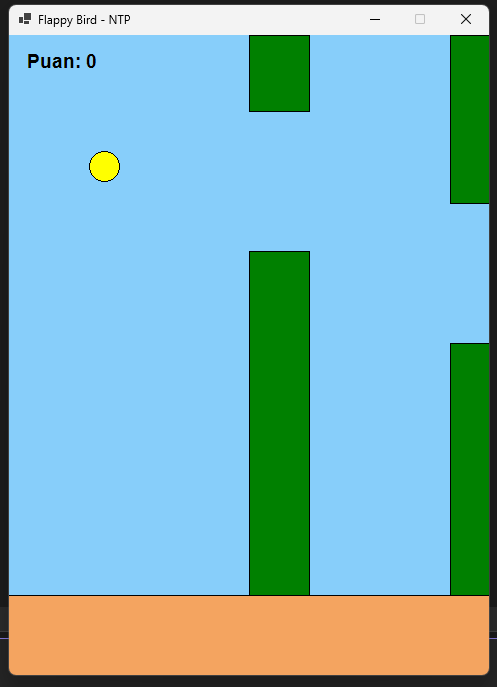
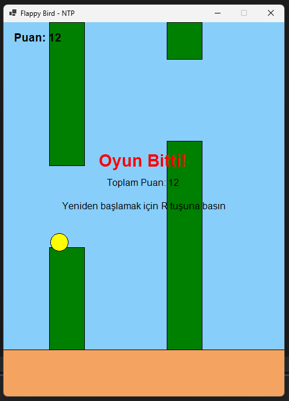

# Flappy Bird

C# ile yaptığım basit bir Flappy Bird oyunu.

## Kullanılan Teknolojiler
- C#
- Windows Forms
- .NET 8

## Özellikler
- Boşluk tuşuyla kuşu zıplatma
- Hareket eden borular
- Puan kazanma
- Çarpışınca oyunun bitmesi
- R tuşuyla yeniden başlatma

## Çalıştırma
Projeyi Visual Studio ile açıp F5'e basarak çalıştırabilirsiniz.

## Ekran Görüntüleri

